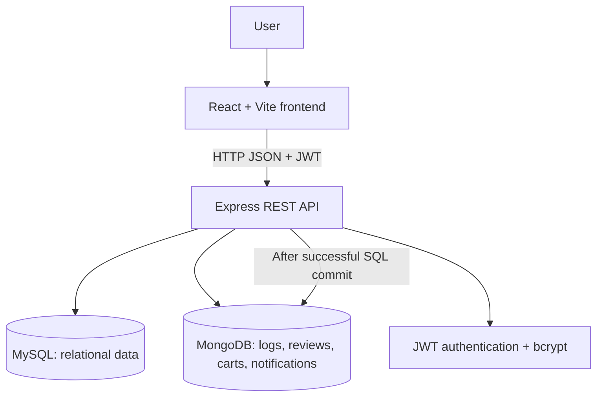

# Architecture

The browser communicates only with the Express backend. The backend owns database access. MySQL stores structured relational data; MongoDB stores flexible documents and activity records.
